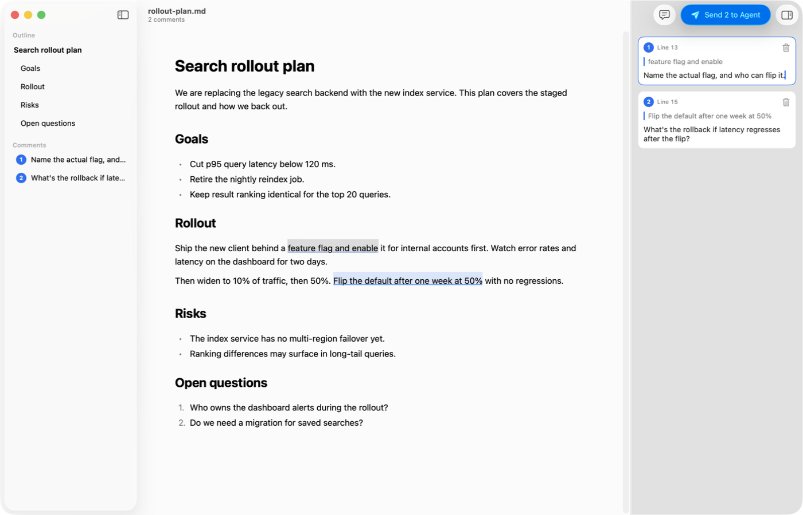

<div align="center">
  
  <h1>mdreview</h1>
  <p>Review Markdown like a pull request, then hand the review to your coding agent.</p>
  <p>A native macOS app · macOS 26 or later · MIT</p>
</div>



## What it does

- **Reads** CommonMark and GitHub Markdown: tables, task lists, strikethrough, footnotes, local images, and YAML front matter as a muted block. Links to other Markdown files open in mdreview.
- **Comment** on any selection in the rendered view. Each comment is anchored to its source lines, saved as you go and restored when you reopen the file, even after a rename or move. Comment on the whole file with ⇧⌥⌘M or the page icon in the inspector header.
- **Send to Agent** (⌘↩) turns every comment into one Markdown review (file path, line ranges, quoted text, your note). It's copied to the clipboard and saved in `~/Library/Application Support/mdreview/Reviews/`.
- **Skip the paste:** an agent runs `mdreview plan.md`, which opens the file and waits like `git commit` waits for its editor. Your review comes back on standard output; closing the window or quitting exits 1. A review sent with no command waiting is queued for the next one.
- **Agents reply** per comment with `mdreview reply plan.md 1a2b3c4d "Renamed to rollout_v2" --resolve`. The card shows **Agent says done** and stays open until you **Resolve** it. [skills/mdreview/SKILL.md](skills/mdreview/SKILL.md) teaches an agent the whole loop, and [docs/journeys.md](docs/journeys.md) walks the main flows.
- **Live:** the view reloads when the file changes and comments follow their text. Ones whose text is gone are marked **Outdated**.
- **Private:** mdreview never writes into your Markdown's folder. Comments, reviews and `mdreview` handoff files live in `~/Library/Application Support/mdreview/`.

A review looks like this:

```markdown
# Review of plan.md

File: `/path/to/plan.md`
Comments: 2. Line numbers refer to the file above. Address each comment, then answer it with
`mdreview reply <file> <id> "<what you did>" --resolve`.

## 1. plan.md:3-4 · id 1a2b3c4d

> feature flag and enable

Name the actual flag.

## 2. plan.md:16 · id 5e6f7a8b

> Flip the default after one week

What's the rollback?
```

The window is glass: the desktop shows through, blurred, behind a frosted layer that keeps text legible. Reduce Transparency or Increase Contrast make it opaque.

## Install

There's no prebuilt download yet; build it from source. You need macOS 26 (Tahoe) and Xcode 26 (Swift 6.2). From a clone of this repository (the file argument is optional):

```sh
swift run mdreview README.md
```

For a standalone app, run `make bootstrap` once, then `make app`. It builds an ad-hoc signed `build/mdreview.app` with its icon; drag it to `/Applications`.

To give agents the `mdreview` command, link the script inside the app into a folder on your `PATH`:

```sh
ln -s /Applications/mdreview.app/Contents/Resources/mdreview /usr/local/bin/mdreview
```

Then an agent runs `mdreview plan.md` and reads your review from the output.

## Usage

| Action | How |
|---|---|
| Open a file | ⌘O, or drop a `.md` file on the window |
| Comment on a selection | Select text, then press ⌥⌘M. A **Comment ⌥⌘M** button floats by the selection; right-click → **Add Comment** and the **+** in the inspector header work too |
| Follow an agent's edits | Nothing to do: the open file reloads when it changes on disk, keeping your scroll position |
| Edit or delete a comment | Type in its card in the inspector, or click the trash icon. Changes save as you make them |
| Comment on the whole file | ⇧⌥⌘M, **Review → Add Page Comment** or the page icon in the inspector header. It shows as **Page** in the inspector, is exported as `file.md (whole file)` with no line range or quote, and is never outdated. Replies, Resolve / Reopen, filters and Send work as for any comment |
| Pick up a review later | Reopen the file; its saved comments come back |
| Jump to a comment or heading | Click it in the inspector or the sidebar. **Review → Next / Previous Comment** (⌃⌘↓ / ⌃⌘↑) or the arrows in the inspector header step through the comments |
| Confirm or reopen an agent's answer | A reply from `mdreview reply` shows under the comment. **Resolve** closes it (Open filter and the next send skip it); **Reopen** brings it back |
| Filter comments | **All / Open / Outdated** in the inspector header, with counts. Resolved comments count as closed |
| Show or hide the sidebar or comments | **View** menu, or the toolbar buttons |
| Send to Agent | ⌘↩, or the toolbar button, which shows the count of open comments (resolved ones are not sent) and stays disabled when there are none. The button is the same width in every state. Overwrites the file's review in `~/Library/Application Support/mdreview/Reviews/` on each send; the result appears as a toast over the document, where you can select the saved path to copy it |
| Review for a waiting agent | The agent runs `mdreview <file>`; an **An agent is waiting** line shows in the inspector header and a green dot appears on the toolbar button. Comment, then send. Every `mdreview` command waiting on that file gets the review; with none waiting, the review is queued for the next one |

## Limitations

- Records for files you delete stay in `~/Library/Application Support/mdreview/` until you remove them.
- One file at a time, and the Markdown is read-only.
- A comment follows its quoted text as rendered, and remembers about 30 characters on each side of it to tell repeated phrases apart. While the file is open, each change is compared line by line, so a comment whose lines are unchanged shifts with them, however many other places one write edits. When an edit touches its lines, it follows its quote only if exactly one copy is left in the changed lines, both before and after the edit, counting only copies with the same surrounding text when the changed lines held several; otherwise it is marked outdated rather than moved to another copy. On reopen, a comment whose quote moved follows it only when exactly one copy is left the same way and that copy keeps the text on at least one side of it; otherwise it is marked outdated, even if the quote just moved into a new sentence. An outdated comment keeps the line numbers of the earlier version and stays outdated, across edits and reopens, until you delete it.
- Send to Agent is clipboard, file and the `mdreview` command; there are no agent plugins or MCP server. The agent protocol is the command line, and the review is queued only until the next `mdreview <file>` for that file, one review per file.
- `mdreview reply` doesn't check the id: a reply to an unknown or ambiguous id is dropped without an error.
- The `mdreview` command runs from the `.app` only, not from `swift run`.
- Remote images show their alt text, footnotes stay where they're defined, raw HTML shows as source, and Mermaid diagrams show as code.
- The `.app` is ad-hoc signed for local use: no Developer ID, notarization or DMG.

## Development

On a fresh clone, run `make bootstrap`, then `make check`. Bootstrap needs [Homebrew](https://brew.sh) and installs the tools in `Brewfile`: [XcodeGen](https://github.com/yonaskolb/XcodeGen), [SwiftLint](https://github.com/realm/SwiftLint) and [Periphery](https://github.com/peripheryapp/periphery). `swift format` ships with the toolchain. `swift test` and the `.app` need full Xcode; the Command Line Tools alone can build and run.

| Target | What it does |
|---|---|
| `make bootstrap` | Install the `Brewfile` tools, check that `xcode-select` points at Xcode, then `make hooks` and `make project`. Safe to rerun |
| `make build` | `swift build` |
| `make run FILE=README.md` | Build and open a file (`FILE` is optional) |
| `make test` | `swift test`: the `MDReviewCoreTests` unit tests (Swift Testing) |
| `make lint` | `swift format lint --strict`, then `swiftlint lint --strict` (rules in `.swiftlint.yml`); fails on violations |
| `make format` | Rewrite sources with `swift format` |
| `make deadcode` | `periphery scan --strict`: fails on unused code (config in `.periphery.yml`) |
| `make docs-check` | Fails when this README's `make` table or Layout section disagrees with the Makefile or the tree |
| `make check` | `lint`, `test`, `deadcode`, then `docs-check`. Must pass before every commit |
| `make hooks` | One-time: use `.githooks/`, so every commit runs `make lint` |
| `make project` | Generate `mdreview.xcodeproj` from `project.yml` (the project is gitignored) |
| `make app` | Release build into `build/mdreview.app` |
| `make uitest` | Run the XCUITest in `UITests/`: open a file, toggle both sidebars, comment, Send to Agent, relaunch and find the comment again; then edit, delete and restore the file; then open a file an `mdreview` command asked for and answer it on Send; then show an agent reply with its badge and resolve it; then add a page comment, send it and resolve it |

Style lives in `.swift-format`, `.swiftlint.yml` and `.editorconfig`. Bundle settings and signing live in `project.yml`; open the generated project in Xcode to debug.

CI (`.github/workflows/ci.yml`) runs `make bootstrap` and `make check` on every pull request and every push to `main`.

`make uitest` drives the real app, so macOS must allow Automation Mode. Enable it once with `automationmodetool enable-automationmode-without-authentication` (it asks for an admin password), or approve the prompt Xcode shows on the first run. It isn't part of `make check`.

[AGENTS.md](AGENTS.md) has the house rules for contributors, human or agent.

## Layout

- `Sources/MDReviewCore/`
  - `MarkdownRenderer.swift`: parses with [swift-markdown](https://github.com/swiftlang/swift-markdown) (CommonMark plus GitHub's extensions) and maps rendered selections back to source lines.
  - `MarkdownBuilder.swift`, `MarkdownBuilder+Inline.swift`, `MarkdownBuilder+Table.swift`, `MarkdownBuilder+Links.swift`: turn the parsed blocks, inlines, tables, footnotes and bare links into the reader's text, tagging every character with the source line it came from.
  - `RenderedMarkdown.swift`: the renderer's output, its headings and the `.sourceLine` attribute.
  - `ReviewComment.swift`: the comment model.
  - `ReviewComment+Reanchor.swift`: moves a comment to its quoted text after the file changes, or marks it outdated.
  - `ReviewExport.swift`: the batched review an agent receives.
  - `ReviewStore.swift`: saved comments and sent reviews, kept in the app's Application Support folder.
  - `ReviewComment+Reply.swift`: merges agent replies into comments by short id.
  - `ReviewStore+Handoff.swift`: the request and answer files behind the `mdreview` command.
  - `ReviewStore+Replies.swift`: reply files and the review queued while no command waits.
- `Sources/mdreview/`: the SwiftUI app.
  - `Main.swift`: starts the app, or the `mdreview` command when the bundled script passes `--wait`.
  - `MDReviewApp.swift`, `AppDelegate.swift`: the scene, menu commands, command-line file argument and opening files an `mdreview` command asks for.
  - `WaitCommand.swift`: the `mdreview <file>` command: opens the file in the app and waits for the review.
  - `ReplyCommand.swift`: `mdreview reply`, which leaves an agent's answer to one comment.
  - `ReviewModel.swift`: the open file, its comments (loaded and saved through the store), live reload and Send to Agent.
  - `FileWatcher.swift`: watches the open file, including atomic saves, deletion and recreation.
  - `Views/`: the split view with a glass sidebar (outline and comments) and the comment inspector.
  - `Reader/`: AppKit bridges: the `NSTextView` reader and the behind-window glass.
- `Tests/MDReviewCoreTests/`: unit tests, one file per type under test (`MarkdownRendererTests.swift`, `ReviewCommentTests.swift`, `ReviewExportTests.swift`, `ReviewStoreTests.swift`).
- `App/`: the app's asset catalog (icon) and `mdreview`, the command-line script the app bundles as a resource. `project.yml` builds the app from `Sources/mdreview` plus the `MDReviewCore` package product.
- `UITests/`: the end-to-end UI test.
- `docs/journeys.md`: the main user journeys as flows, each naming the UI test that covers it. `docs/images/` holds the screenshot.
- `skills/mdreview/SKILL.md`: the agent skill that teaches the review loop.
- `.github/workflows/ci.yml`: the `check` job, which runs `make check` on GitHub Actions.
- `scripts/docs-check.sh`: the README freshness check behind `make docs-check`; it also checks that every test named in `docs/journeys.md` exists.

## License

MIT. See [LICENSE](LICENSE).
