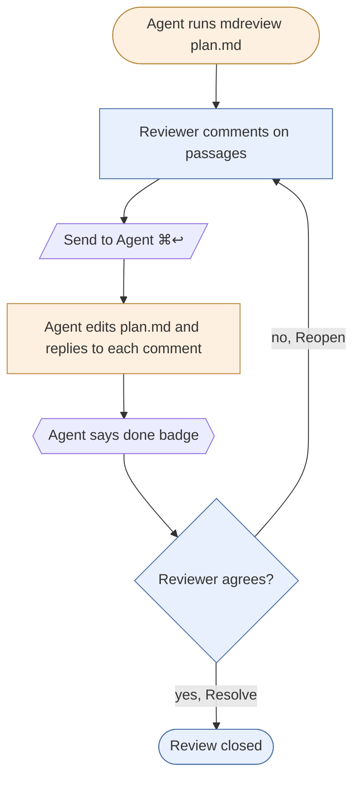
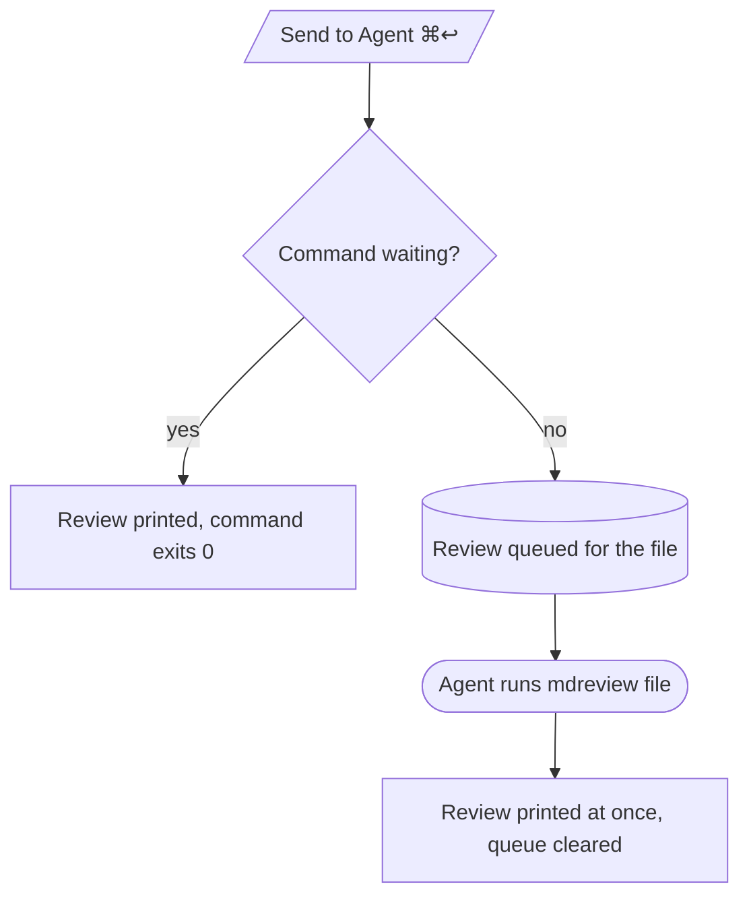

# User journeys

The flows that must keep working. Each names the UI test that walks it (`make uitest`); `make docs-check` fails if that test is renamed or deleted.

## Review a document an agent wrote

**Goal:** When an agent has written a plan, I want to comment on it in place and hand the comments back, so the agent fixes exactly what I flagged.

**Starts when:** the agent runs `mdreview plan.md`, which opens the file and waits.

1. The agent runs `mdreview plan.md`. The app opens the file and the command waits.
2. The reviewer selects text and comments. Comments save as they go.
3. The reviewer presses **Send to Agent**. The review goes to the command's standard output and it exits 0.
4. The agent edits `plan.md` and answers each comment with `mdreview reply <file> <id> "<what changed>" --resolve`. Each answered comment shows an **Agent says done** badge, and comments re-anchor to the edited text.
5. The reviewer clicks **Resolve** on each answer they accept, or **Reopen** to go back to step 2. The next review carries the agent's earlier reply.

**Ends when:** every comment is resolved.
**If it goes wrong:** closing the window, quitting the app or opening another file makes the command exit 1. An edit that rewrites a comment's text marks it **Outdated** instead of moving it. If no command is waiting when the reviewer sends, see the next journey.
**Covered by:** `testOpensTheRequestedFileAndAnswersOnSend`, `testAgentReplyShowsOnTheCardAndTheReviewerResolvesIt`

## Send while no agent is waiting

**Goal:** When the agent has stopped waiting, I want my review kept, so the agent still gets it.

**Starts when:** the reviewer presses **Send to Agent** and no `mdreview <file>` command is running.

1. The reviewer sends. The toast shows the saved path, and the review is also on the clipboard.
2. With no command waiting, the app queues the review for that file (one per file; a newer send replaces it).
3. The next `mdreview plan.md` prints the queued review and exits 0 without waiting.

**Ends when:** an agent has read the review.
**If it goes wrong:** the queue is only for `mdreview <file>`; an agent that never runs it never sees the review, so paste it, or point the agent at the saved file.
**Covered by:** `testSendWithNoAgentWaitingQueuesTheReview`

## Review by hand, then paste into any agent

**Goal:** When my agent has no `mdreview` command, I want a review I can paste, so any agent can act on it.

**Starts when:** the reviewer opens a `.md` file (⌘O, drag, or `swift run mdreview plan.md`).

1. The reviewer selects text and comments (⌥⌘M). Comments save as they go and come back when the file is reopened.
2. The reviewer presses **Send to Agent** (⌘↩). The review is copied to the clipboard and saved as `<name>-<hash>.review.md` in the app's storage.
3. The reviewer pastes it into Claude Code, Codex or any agent, or points the agent at the saved file.

**Ends when:** the agent has the review.
**If it goes wrong:** if the file changes meanwhile, comments follow their text or show **Outdated**, and the review labels them.
**Covered by:** `testToggleSidebarsCommentSendAndReopen`
